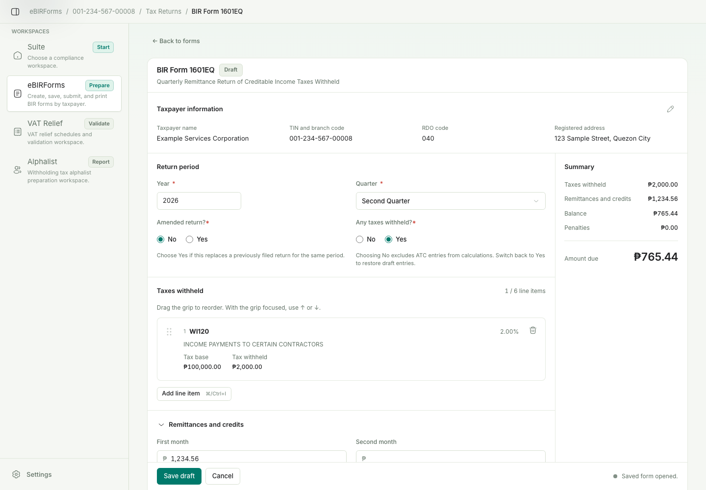
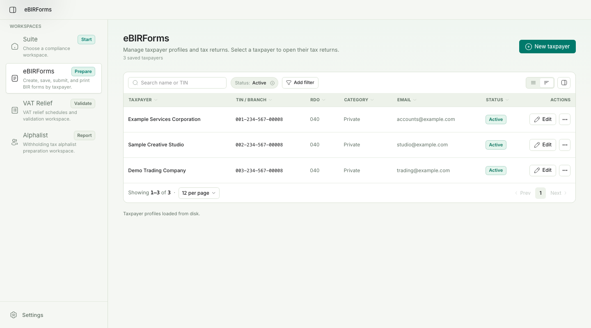
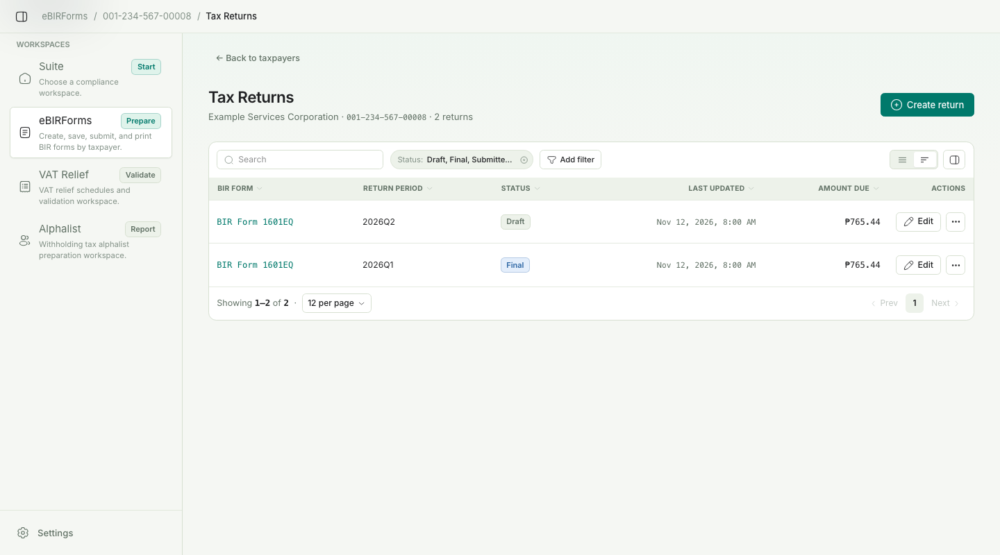
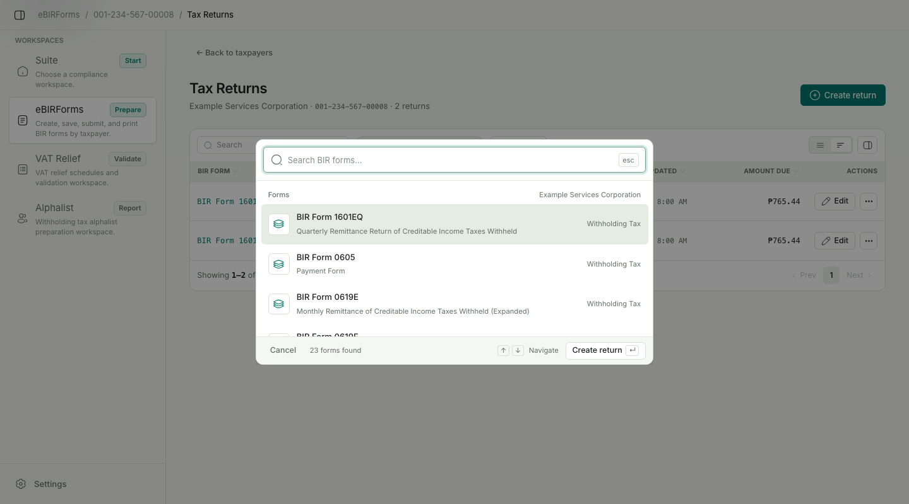

  

<h1 align="center">TaxMate PH</h1>

<strong>Your taxpayers. Your returns. One workspace.</strong>

  <a href="#why-taxmate-ph-was-created">Why TaxMate PH</a> ·
  <a href="#what-you-can-do-today">Features</a> ·
  <a href="#a-look-inside">Screenshots</a> ·
  <a href="#currently-supported-ebirforms">Supported forms</a>

TaxMate PH is a Philippine tax preparation workspace for managing taxpayers,
preparing supported BIR returns, checking entries, and generating printable PDFs.
Its current working module is **eBIRForms**, with **23 supported form versions**.

The project is a proof of concept and is not an official BIR application. Its
calculations and form coverage do not establish current legal applicability or
guarantee BIR acceptance.

*Form 1601-EQ preparation with fictional sample data.*

## Why TaxMate PH was created

TaxMate PH grew out of frustration with the legacy eBIRForms app and its
Windows-only availability. Preparing Philippine tax returns should be easier to
manage and accessible to people using other operating systems.

The goal is to bring workflows commonly handled through separate desktop
utilities into a consistent workspace: maintain taxpayer details once, reuse them
across returns, save work by reporting period, and review forms before sending or
printing them.

The broader aim is to make these workflows accessible across macOS, Windows,
Linux, and Android, and eventually bring eBIRForms, VAT RELIEF, and Alphalist
together. Platform coverage and the planned modules are still being developed.

## What you can do today

- **Manage multiple taxpayers.** Save taxpayer profiles with TIN, branch, RDO,
  registered address, contact details, and classification. Reuse those details
  when preparing returns.
- **Create and save returns by taxpayer and period.** Reopen saved drafts,
  review their status and amount due, and search or filter the forms list.
- **Prepare supported payment and withholding forms.** Enter amounts and
  schedules, select applicable ATCs, and use form-specific calculations for
  totals, credits, remittances, and balances.
- **Check entries before finalizing.** Review highlighted missing or inconsistent
  values and mark validated returns as final locally. Penalty amounts are entered
  manually; the app does not calculate them from days late.
- **Export printable PDFs.** Generate the packaged forms' original layouts on
  A4, Letter, or Long paper, with continuation pages for additional schedule rows.
- **Prepare locally or send eligible returns.** Prepare a return package on your
  device without uploading, or use the desktop sending workflow for Form 1601-EQ.
- **Review submission history and logs.** Inspect locally recorded uploads and
  preparation results. Archive and restore taxpayers or returns, or delete working
  copies while retaining submission history.
- **Keep working records on your device.** Taxpayer profiles, saved returns, and
  preferences are stored locally. Choose light or dark appearance and a default
  paper size.

## A look inside

These screenshots show the current interface with fictional sample records.

### Keep taxpayer records together

Find a taxpayer by name or TIN, review their profile, and open their returns.

### Track returns by period and status

Review saved drafts and final copies for each taxpayer, then open a return to
continue preparing it. Final status means it was finalized locally.

### Choose a supported BIR form

Search the form chooser to start a new return, including the available legacy
and revised form versions.

## Currently supported eBIRForms

All versions below support preparation, calculation and validation, saved working
copies, local finalization, local package preparation, and PDF output.
**Sending to BIR is currently limited to Form 1601-EQ.**

### Payment and monthly remittance forms

| Form | Purpose | Version available |
| --- | --- | --- |
| 0605 | Payment form | Packaged version |
| 0619-E | Monthly remittance of creditable income taxes withheld — expanded | 2018 version |
| 0619-F | Monthly remittance of final income taxes withheld | 2018 version |
| 1600 | Monthly remittance of VAT and other percentage taxes withheld | Packaged version |
| 1600-PT | Monthly remittance of other percentage taxes withheld | 2018 version |
| 1600-VT | Monthly remittance of VAT withheld | 2018 version |
| 1600-WP | Remittance of percentage tax on winnings and prizes | Packaged version |
| 1601-C | Monthly remittance of income taxes withheld on compensation | Legacy and 2018 versions |
| 1601-E | Monthly remittance of creditable income taxes withheld — expanded | Legacy, pre-2018 |
| 1601-F | Monthly remittance of final income taxes withheld | Legacy, pre-2018 |
| 1602 | Monthly remittance of final income taxes withheld on interest paid | Legacy, pre-2018 |

### Quarterly remittance forms

| Form | Purpose | Version available |
| --- | --- | --- |
| 1601-EQ | Quarterly remittance of creditable income taxes withheld — expanded | Packaged version |
| 1601-FQ | Quarterly remittance of final income taxes withheld | 2018 version |
| 1602-Q | Quarterly remittance of final income taxes withheld on interest paid | 2018 version |
| 1603 | Quarterly remittance of final income taxes withheld on fringe benefits | Legacy, pre-2018 |
| 1603-Q | Quarterly remittance of final income taxes withheld on fringe benefits | 2018 version |

### Annual information and real property forms

| Form | Purpose | Version available |
| --- | --- | --- |
| 1604-C | Annual information return of income taxes withheld on compensation | Packaged version |
| 1604-CF | Annual information return of income taxes withheld on compensation and final withholding taxes | Legacy version |
| 1604-E | Annual information return of creditable income taxes withheld — expanded | Legacy and 2018 versions |
| 1604-F | Annual information return of income payments subjected to final withholding taxes | Packaged version |
| 1606 | Withholding tax remittance for onerous transfer of real property | Packaged version |

The 23-version count includes separate legacy and 2018 versions of 1601-C and
1604-E. Coverage is based on the supplied **eBIRForms v7.9.6.0** package; a form's
presence in the app does not mean that version applies to a particular filing
period. Annual information returns reconcile remittances and have no amount payable.

## Sending and filing status

The desktop app provides **Send to BIR** and **Prepare locally** modes. Live sending
is currently limited to **1601-EQ** and requires configured submission credentials,
available BIR services, and a verified OpenSSH server key in
`settings/bir-known-hosts` under the app data directory. Unknown or changed keys
are rejected before authentication; the app never trusts a presented key automatically. Other
supported forms can be prepared locally but cannot currently be uploaded through
the app.

A **Submitted** status records a successful upload. It does not establish BIR
acceptance or replace an acknowledgment. The app does not retrieve BIR confirmation
emails, acknowledgment reference numbers, or subsequent processing status. Marking
a return **Final** or exporting its PDF is also a local action, not proof of filing.

Submission compatibility fixtures come from the supplied installer serializer and
original cipher instructions. Local tests cover payload mapping, encryption,
dispatcher fallback, and loopback SFTP completion without contacting BIR. See
[the compatibility fixtures](src-tauri/tests/fixtures/submission/README.md) and
[local SFTP test instructions](src-tauri/tests/fixtures/submission/sftp-tests.md).

## Planned workspaces

- **VAT RELIEF:** preparation and validation of VAT Summary Lists of Sales and
  Purchases, with submission-file generation.
- **Alphalist:** preparation and validation of withholding-tax alphalists and
  related submission files.

These workspaces are currently placeholders. Forms outside the list above,
including income tax and regular VAT returns, are not yet supported.
