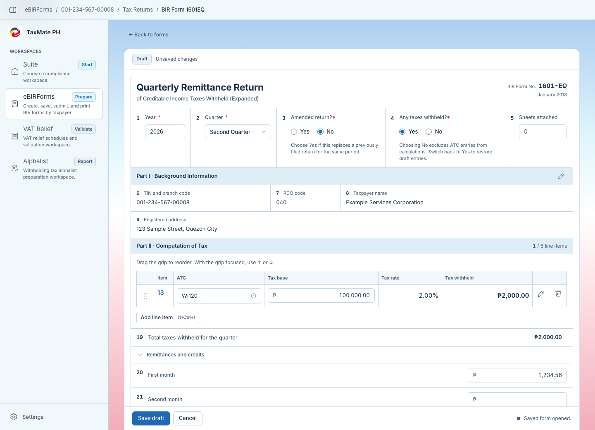
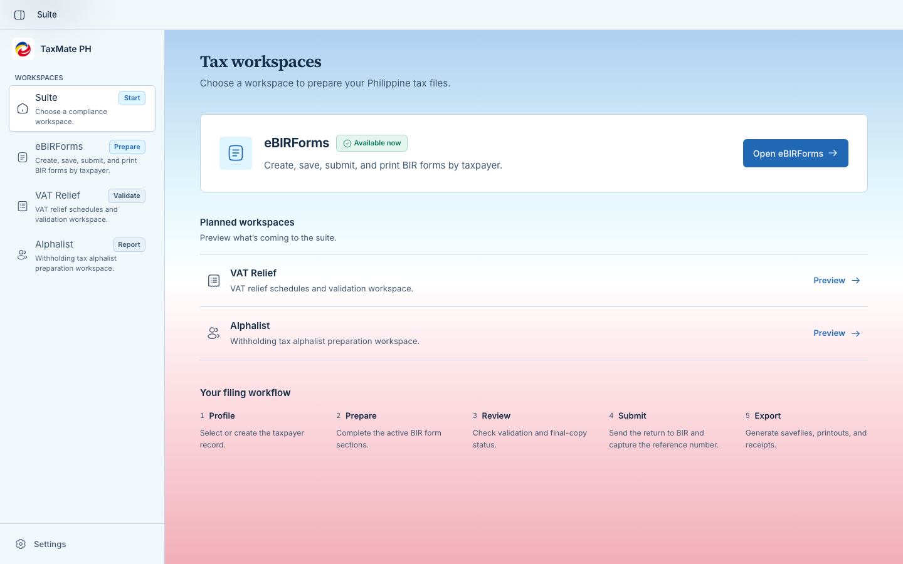
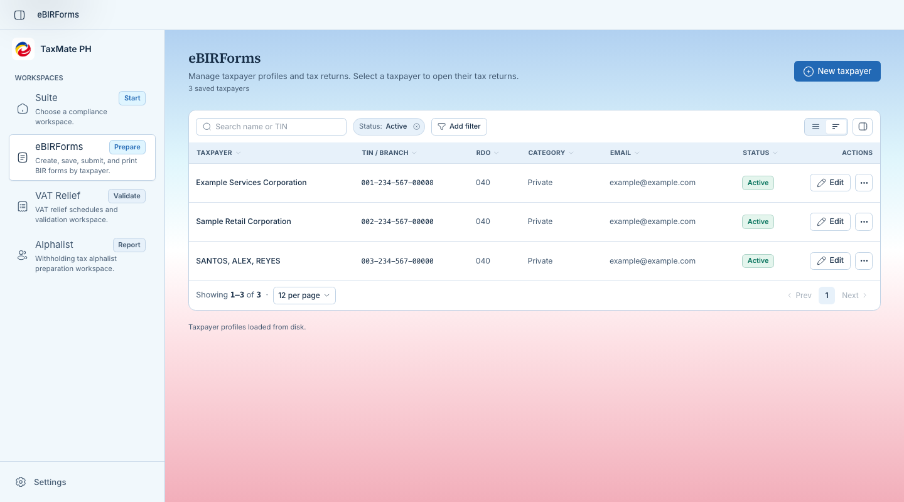
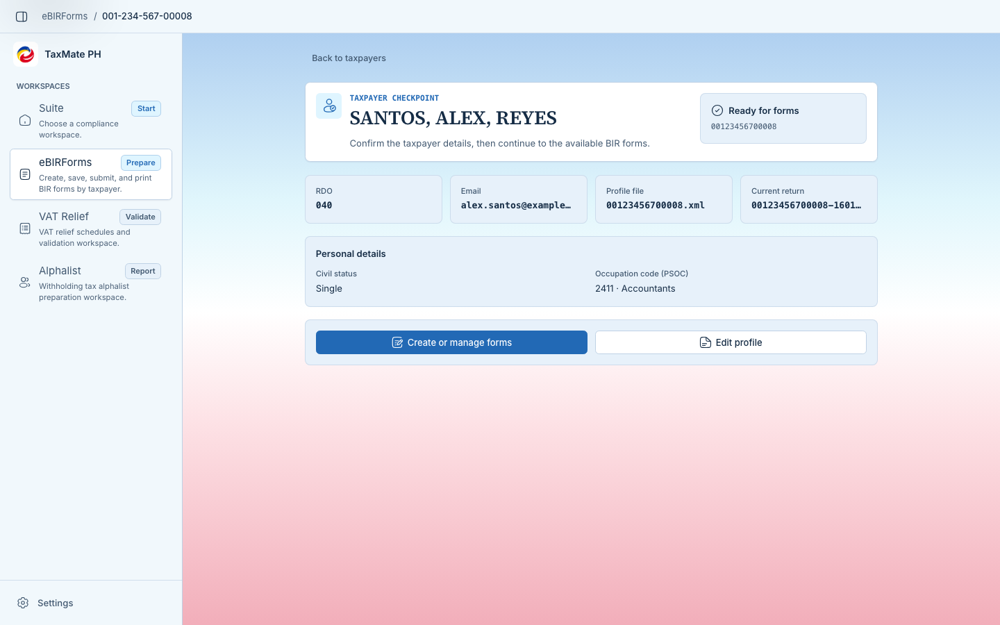
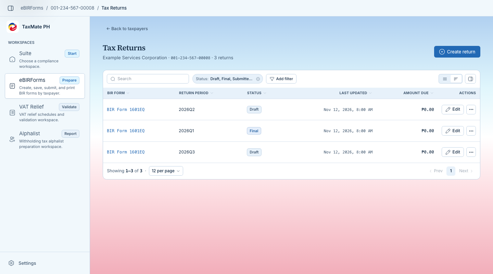
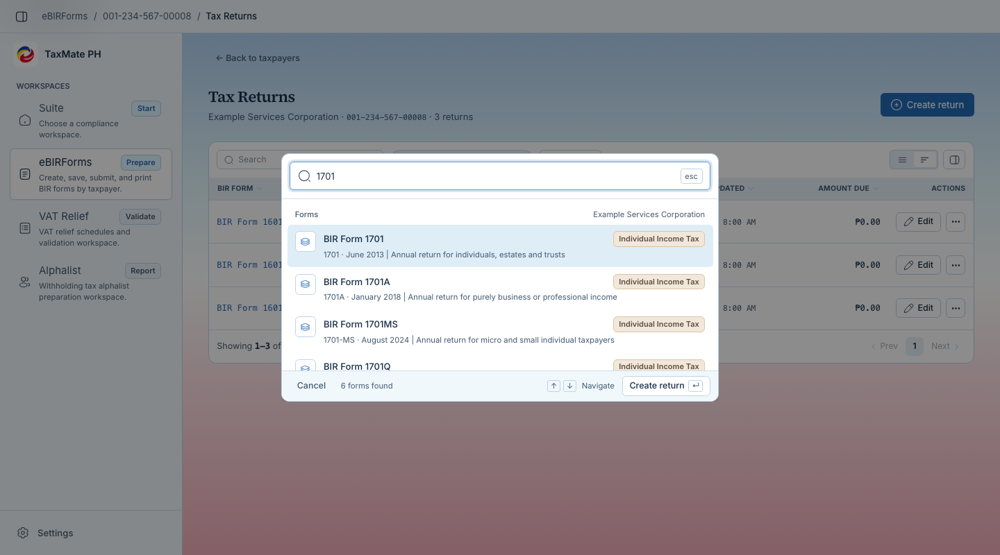
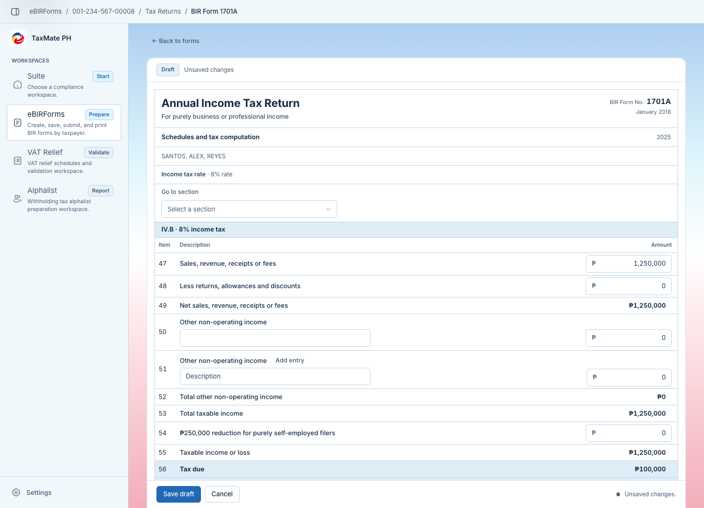
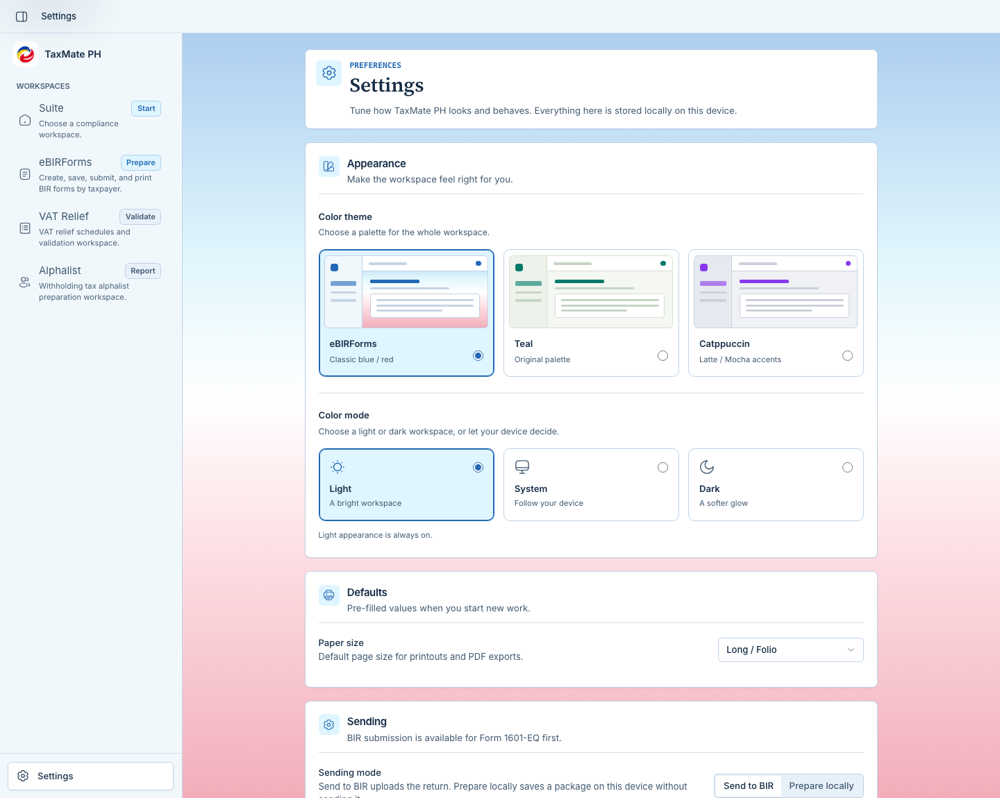

<p align="center">
  
</p>

<h1 align="center">TaxMate PH</h1>

<p align="center">A desktop workspace for preparing Philippine BIR returns.</p>

<p align="center">
  <a href="#features">Features</a> ·
  <a href="#app-tour">App tour</a> ·
  <a href="#supported-bir-forms">Supported forms</a> ·
  <a href="#sending-and-filing-status">Sending and filing status</a> ·
  <a href="#run-from-source">Run from source</a>
</p>

Manage taxpayer profiles, reuse details across returns, and keep draft and final
copies by reporting period. The eBIRForms workspace covers **31 form versions**,
including **23 payment and withholding versions** and **8 individual income tax
versions**.

TaxMate PH is a cross-platform proof of concept. For filing requirements and
accepted forms, refer to the Bureau of Internal Revenue.



*Form 1601-EQ with fictional sample data.*

## Features

| Feature | What you can do |
| --- | --- |
| Taxpayer profiles | Keep TIN, branch, RDO, address, contact, and classification details on your device. Reuse them when creating returns. |
| Form preparation | Choose from legacy and revised forms. Work through form-specific fields and schedules, select alphanumeric tax codes (ATCs), and review calculated totals, credits, remittances, or balances. |
| Validation and saved returns | Review highlighted entries, save drafts, and mark validated copies final locally. Find returns by period and status, and archive or restore working records. Enter penalty amounts manually where applicable. |
| PDF export | Generate printable copies in A4, Letter, Long / Folio, or Legal. Supported withholding schedules can continue on additional pages. |
| Return packages and history | Prepare packages locally, use desktop sending for eligible 1601-EQ returns, and review locally recorded results and submission logs. |
| Workspace preferences | Choose an eBIRForms, Teal, or Catppuccin palette, set light, dark, or system appearance, and save a default paper size. |

## App tour

The screenshots use fictional sample records.

### Workspace home

Open eBIRForms to start preparing returns, or preview the planned VAT Relief and
Alphalist workflows.



### Taxpayers and profiles

Find taxpayers by name or TIN. Create or edit a profile, then review its
registration, personal, or spouse details where applicable before opening the
taxpayer’s returns.





### Tax Returns and form chooser

Review a taxpayer’s saved returns, reporting periods, amounts due, and status.
Open an existing return or choose **Create return** to search the catalog by
form number, title, or category. The return’s action menu includes PDF export
and finalization.





### Return editor

Start with taxpayer details filled in from the selected profile. Withholding
editors show ATC line items and remittance totals. Individual income tax editors
provide form-specific sections for income, deductions, credits, and
calculations.



### Settings and submission log

Set the app’s appearance, default paper size, and sending mode. On desktop,
open the submission log to review preparation, connection, and upload results.



## Supported BIR forms

### Payment and monthly remittance forms

| Form | Purpose | Available revisions |
| --- | --- | --- |
| 0605 | Payment form | September 2003 |
| 0619-E | Monthly remittance of creditable income taxes withheld — expanded | January 2018 |
| 0619-F | Monthly remittance of final income taxes withheld | January 2018 |
| 1600 | Monthly remittance of VAT and other percentage taxes withheld | September 2005 |
| 1600-PT | Monthly remittance of other percentage taxes withheld | January 2018 |
| 1600-VT | Monthly remittance of VAT withheld | January 2018 |
| 1600-WP | Remittance of percentage tax on winnings and prizes | January 2010 |
| 1601-C | Monthly remittance of income taxes withheld on compensation | July 2008 and January 2018 |
| 1601-E | Monthly remittance of creditable income taxes withheld — expanded | September 2007 |
| 1601-F | Monthly remittance of final income taxes withheld | September 2005 |
| 1602 | Monthly remittance of final income taxes withheld on interest paid | August 2001 |

### Quarterly remittance forms

| Form | Purpose | Available revisions |
| --- | --- | --- |
| 1601-EQ | Quarterly remittance of creditable income taxes withheld — expanded | January 2018 |
| 1601-FQ | Quarterly remittance of final income taxes withheld | January 2018 |
| 1602-Q | Quarterly remittance of final income taxes withheld on interest paid | January 2018 |
| 1603 | Quarterly remittance of final income taxes withheld on fringe benefits | November 2004 |
| 1603-Q | Quarterly remittance of final income taxes withheld on fringe benefits | January 2018 |

### Annual information and real property forms

| Form | Purpose | Available revisions |
| --- | --- | --- |
| 1604-C | Annual information return of income taxes withheld on compensation | January 2018 |
| 1604-CF | Annual information return of income taxes withheld on compensation and final withholding taxes | July 2008 |
| 1604-E | Annual information return of creditable income taxes withheld — expanded | July 1999 and January 2018 |
| 1604-F | Annual information return of income payments subjected to final withholding taxes | January 2018 |
| 1606 | Withholding tax remittance for onerous transfer of real property | July 1999 |

### Individual income tax

| Form | Available revisions |
| --- | --- |
| 1700 | June 2013 and January 2018 |
| 1701 | June 2013 and January 2018 |
| 1701A | January 2018 |
| 1701-MS | August 2024 |
| 1701Q | July 2008 and January 2018 |

## Sending and filing status

Use **Prepare locally** to save a return package on your device. **Send to BIR**
is available for **Form 1601-EQ** in the desktop app and requires configured
submission credentials, an available BIR service, and a verified OpenSSH server
key in `settings/bir-known-hosts` under the app data directory. Unknown or changed
server keys are rejected before authentication.

| Status | What it records |
| --- | --- |
| Draft | A saved working copy you can reopen and edit. |
| Final | A return that passed the app’s validation and was marked final locally. |
| Submitted | A successful upload. BIR receipt, acceptance, and processing status must be confirmed separately. |

PDF exports are local copies. BIR acknowledgment emails and reference numbers
are handled outside the app. For technical details, see the
[submission data flow](docs/bir-submission-dataflow.md) and
[compatibility fixtures](src-tauri/tests/fixtures/submission/README.md). See the
[local SFTP test instructions](src-tauri/tests/fixtures/submission/sftp-tests.md)
to exercise submission handling without connecting to BIR.

## Planned workspaces

- **VAT Relief** will cover VAT Summary Lists of Sales and Purchases, including
  validation and submission-file generation.
- **Alphalist** will cover withholding-tax alphalists, including validation and
  related submission files.

Both pages currently preview the planned workflows. Corporate income tax and
regular VAT returns are outside the current forms catalog.

## Run from source

TaxMate PH uses SvelteKit and Tauri. With Bun, Rust, and the platform’s Tauri
prerequisites installed, run the following from the repository root.

```sh
bun install
bun run tauri dev
```

Use `bun run dev` for a browser preview of the interface. PDF export and live
sending require the desktop app. PDF export uses a Chromium-compatible browser.
See the [PDF renderer setup](src-tauri/binaries/README.md).

```sh
bun run check
bun run test:run
bunx playwright install chromium
bun run test:browser
```

Set `EBIRFORMS_CAPTURE_TEST_PDFS=1` to capture extra print previews in the
Playwright output directory. PDF fidelity tests also place their verified
PDFs and diagnostics there.
