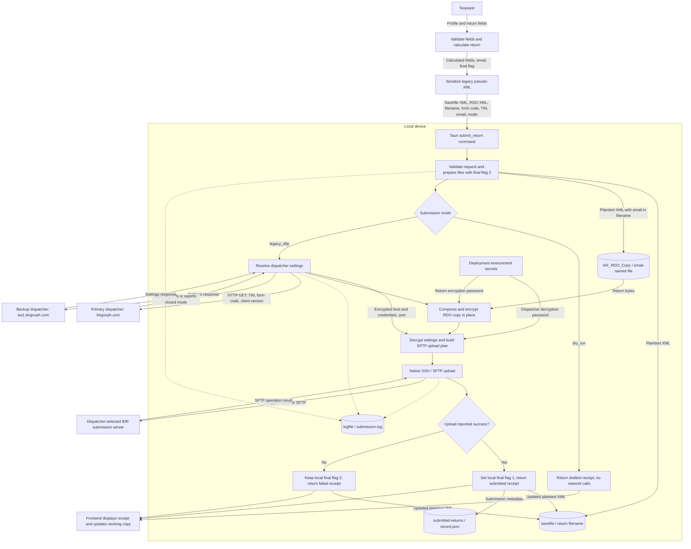

# BIR return submission dataflow

This document describes the submission flow implemented in this repository. TaxMate PH is a proof of concept; the diagram describes application behavior, not verified BIR acceptance or processing. Live submission currently supports **Form 1601-EQ (`1601EQ`) only**.

The document sent is a generated tax return in the legacy eBIRForms pseudo-XML format. This submission path does not upload arbitrary PDF attachments, supporting documents, VAT RELIEF files, or Alphalists.

## Dataflow diagram

Solid arrows show data movement or control flow; dotted arrows show diagnostic logging. The dispatcher supplies a destination; the return file itself goes to the selected SFTP server.

## Submission steps

1. **Prepare the return.** `submitCurrentReturn()` checks the supported form and validates the return, then applies calculations. `serializeLegacyXml()` produces records such as `
field=valuefield=
`, with an XML declaration and the legacy BIR footer. The taxpayer email and `txtFinalFlag` are included. For live 1601-EQ, `serialize1601EQSubmissionXml()` separately produces original-control-ID RDO records with raw values and installer whitespace; escaped logical-field savefiles remain unchanged.
2. **Cross the frontend/backend boundary.** `createSubmissionClient()` invokes the Tauri `submit_return` command with `xml`, live `rdoXml`, `returnFilename`, `formCode`, `tin`, `email`, `mode`, and `fetchDispatcher`. The normal UI enables dispatcher fetching for live submission and supplies no manual dispatcher settings. Blocking file and network work runs in the Rust backend.
3. **Prepare local copies.** The backend checks required values and filename/email constraints, preserves discoverable legacy submission history, and writes separate savefile and RDO copies with `txtFinalFlag=2`. An OS file lock prevents simultaneous preparation/submission of the same return. Live requests require an explicit RDO payload. All paths below are relative to Tauri's application data directory.
4. **Stop here for local preparation.** `dry_run` returns `status=drafted`, leaving both files as plaintext and performing no dispatcher lookup or upload. Saving a draft uses this mode too.
5. **Look up the destination for live submission.** `legacy_sftp` calls the primary dispatcher. Request failure, response-parsing failure, or missing/null/zero mode triggers one attempt against the backup dispatcher. Each HTTP request has an eight-second timeout. Response reading and data-only parsing are bounded to 16 KiB.
6. **Prepare the upload.** The RDO copy is zlib-compressed at level 9, then encrypted with the legacy DCPcrypt-compatible AES-256 transformation. DCPcrypt initializes CBC with AES of sixteen zero bytes and handles a final partial block without padding. Unique temporary files replace the encrypted RDO copy atomically. Its `.xml` filename remains, but its contents are encrypted bytes. The backend decrypts the dispatcher's server, username, and password, checks its mode and port, and builds the remote path.
7. **Send over SFTP.** The Rust `ssh2` client opens a TCP connection, performs an SSH handshake, verifies the server key against app-data `settings/bir-known-hosts` before password authentication, authenticates with the dispatched username/password, creates the remote file, and copies the encrypted local file into it, and explicitly checks remote CLOSE. Unknown/changed keys or CLOSE errors fail the upload. TCP connect attempts share an eight-second deadline; socket/libssh2 I/O timeouts are 30 seconds. DNS remains governed by the OS resolver. The code uses the dispatcher's `port`; `sslPort` is parsed but unused.
8. **Record the result locally.** An upload function result of `Ok(())` maps to `exitCode=0`, `status=submitted`, and local `txtFinalFlag=1`. An upload error maps to `exitCode=1`, `status=failed`, and local flag `2`. The frontend displays the receipt, refreshes submitted history on success, and persists the captured working copy for receipts whose status is not `failed`.

Dispatcher, encryption, and upload-plan errors reject the command with a `SubmissionError` instead of returning a failed receipt. Local files may already exist at that point. The backup dispatcher is only used for dispatcher lookup failures or a primary closed-mode response; SFTP failure does not trigger a backup upload or automatic retry.

## External requests and payloads

| Destination | Protocol / path | Data sent | Data returned |
| --- | --- | --- | --- |
| Primary dispatcher | HTTP GET `http://birgovph.com/tinDispatcherSFTP.php?t=<tin>&f=1601EQ&v=7.9.6.0` | Nine-digit TIN without branch code, form code, hardcoded client version | `mode`, encrypted `server`, `username`, `password`, plus `port` and `sslPort` |
| Backup dispatcher | HTTP GET `http://ws1.birgovph.com/tinDispatcherSFTP.php` with the same query parameters | Same routing metadata, when primary lookup fails or reports filing closed | Same settings structure |
| Dispatcher-selected submission server | SSH / SFTP to the decrypted host and dispatched port; remote path `/1601EQ/<return-stem>#<email>#.xml` | Compressed, encrypted return bytes; email also appears in the remote filename | SFTP operation success or error |

These are endpoint constants in the code, not a claim that the services are currently reachable. Dispatcher responses may be JSON or bounded data-only object literals with quoted/unquoted keys and string/numeric scalar fields; executable expressions are rejected. `mode="0"` disables SFTP. Backend callers can provide manual dispatcher settings when `fetchDispatcher=false`; the normal UI fetches them automatically.

## Local data and secrets

| Location / input | Purpose |
| --- | --- |
| `savefile/<returnFilename>` | Plaintext return. Starts with flag `2`; updated to flag `1` after upload success. |
| `IAF_RDO_Copy/<return-stem>#<email>#.xml` | Upload copy. Plaintext in dry-run; compressed and encrypted before live upload. The uploaded content retains the prepared flag `2`; only the local savefile is rewritten after success. |
| `submitted-returns/<id>.json` | Local submission metadata, including time, form, taxpayer, period, amount, and savefile path. This is an application history record. |
| `logfile/submission.log` | Append-only diagnostic log containing routing and file information, stages, and errors. |
| `EBIRFORMS_DISPATCHER_SECRET_PASSWORD` | Deployment secret used to decrypt dispatcher values: Base64 decoding, PBKDF2-HMAC-SHA1 with 100,000 iterations, then AES-256-CBC with PKCS#7 padding. |
| `EBIRFORMS_RETURN_COPY_PASSWORD` | Deployment secret whose SHA-256 digest supplies the return-copy encryption key. The implementation uses the legacy block/chaining transformation, including partial-block handling. |

Live submission loads environment settings through `dotenvy` at the Tauri command boundary. The submission engine reads the two named environment variables; secret values are not part of the frontend request.

The return filename is built from the normalized taxpayer/branch identifier, form code, and return period, with an optional version suffix. The email-named copy adds `#<email>#` before `.xml`.

## Meaning of a successful submission

**`submitted` means the native SFTP upload function returned success.** The receipt is generated locally and includes status, final flag, file paths, dispatcher URL, an internal exit code, a log path, and a message. The exit code is an application result code, not an external executable's process status. The receipt records the selected dispatcher URL, including the backup when used.

This flow has no BIR business-validation response, acknowledgment reference number, processing-status query, or email-confirmation retrieval. Any subsequent BIR processing or acknowledgment email is outside this implementation. The email address is included in the return and filename; this app does not send the return through SMTP.

After upload success, failures to save local history or update the plaintext copy are returned as warnings while retaining `status=submitted`, so a local persistence failure does not imply that another upload is needed. A local final flag alone is also not proof of remote acceptance: the UI can mark a return final locally, and history can import legacy files carrying flag `1`.

The dispatcher requests use plain HTTP. SFTP verifies a pre-provisioned OpenSSH host key in app-data `settings/bir-known-hosts` before authentication. Keys must be provisioned from a trusted source; the app never automatically trusts or replaces them.

## Source map

| Source | Relevant behavior |
| --- | --- |
| [Workspace](../src/lib/ebirforms/ebirforms-workspace.svelte.ts) | `generatedXml`, `saveDraft()`, `validateReturn()`, `submitCurrentReturn()`, working-copy updates |
| [RDO serializer](../src/lib/legacy/submission-xml.ts) | Installer-compatible 1601-EQ upload IDs, booleans, values and whitespace |
| [Legacy serializer](../src/lib/legacy/xml.ts) | `serializeLegacyXml()` and escaping |
| [Filename helpers](../src/lib/profiles/profile.ts) | `buildReturnFilename()`, `normalizeTinNumber()` |
| [Submission client](../src/lib/tauri/submission.ts) | IPC request, receipt, and error types |
| [Rust submission engine](../src-tauri/src/submission.rs) | Dispatcher lookup, local files, encryption, SFTP, receipts, and logs |
| [Return history](../src-tauri/src/return_history.rs) | Submission metadata persistence and legacy history import |
| [Backend submission tests](../src-tauri/tests/submission.rs) | Filename/query formats, dispatcher parsing/decryption, encryption round-trip, dry-run, and form restrictions |

Compatibility tests use original-instruction cipher vectors, original-source serializer replay, bounded dispatcher fixtures, and an explicitly invoked loopback SFTP server. The full local pipeline verifies success/failure receipts, final flags, history, and decrypted upload bytes. No BIR service was contacted; Windows ANSI byte encoding and actual BIR acceptance remain unverified.
